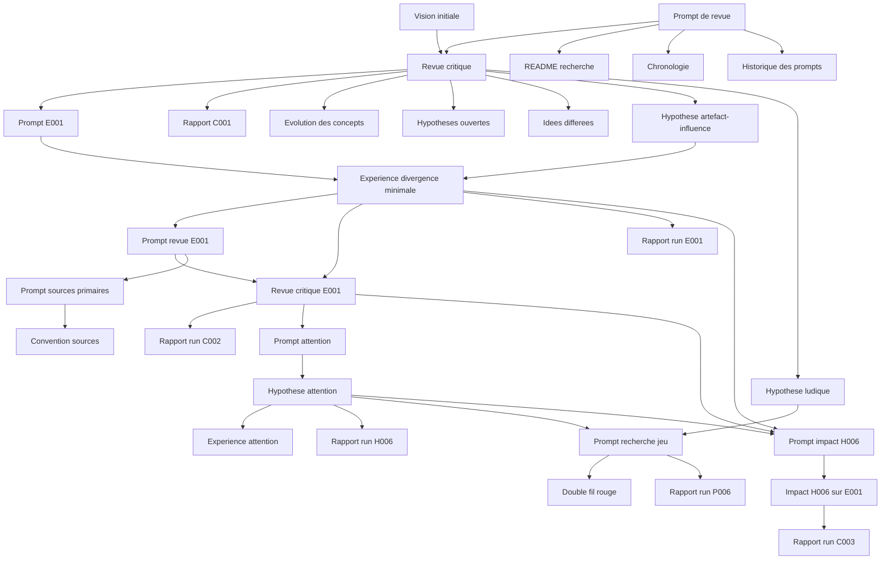

# Provenance des artefacts

## Convention

Les filiations ci-dessous representent uniquement les relations documentees lors de l'initialisation du 2026-07-18. Les liens incertains doivent etre marques comme tels.

## Registre

### P001 - Prompt de revue et de memoire de conception

- Chemin : `docs/research/prompts/P001-initialize-design-review.md`
- Type : prompt
- Statut : reconstruction documentaire, texte exact non disponible localement
- Origine : utilisateur
- Artefacts parents : aucun artefact parent local documente
- Artefacts derives : `C001`, `D002`, `D003`, `D004`, `D005`, `D006`, `D007`
- Transformation appliquee : demande de revue critique et d'initialisation documentaire
- Justification : etablir une memoire honnete de l'evolution intellectuelle de PALIMPSEST.

### D001 - Document initial de vision

- Chemin : `codex-initialize-palimpsest.md`
- Type : document de vision et prompt d'initialisation
- Statut : vision de travail non validee
- Origine : utilisateur avec aide de ChatGPT
- Artefacts parents : filiation anterieure non documentee dans le depot
- Artefacts derives : `C001`
- Transformation appliquee : lecture critique par Codex
- Justification : identifier les forces, fragilites, hypotheses et prochaines experiences avant implementation.

### C001 - Revue critique du document initial

- Chemin : `docs/research/codex-initialize-palimpsest-review.md`
- Type : critique de conception
- Statut : revue de conception, non decisionnelle
- Origine : Codex, a partir de `P001` et `D001`
- Artefacts parents : `P001`, `D001`
- Artefacts derives : `H001`, `H002`, `H003`, `H004`, `H005`, `E001`, `E002`, `E003`
- Transformation appliquee : analyse critique, separation des concepts, hypotheses, risques et experiences candidates
- Justification : rendre la vision testable sans figer prematurement l'architecture.

### P002 - Prompt de formalisation de E001

- Chemin : `docs/research/prompts/P002-formalize-E001.md`
- Type : prompt
- Statut : texte source conserve
- Origine : utilisateur
- Artefacts parents : `C001`, `D005`, `D006`
- Artefacts derives : `E001`
- Transformation appliquee : demande de formalisation de l'experience minimale capable de tester `H001` avant toute implementation
- Justification : transformer une experience candidate en protocole falsifiable, causalement inspectable et limite au plus petit monde utile.

### P003 - Prompt de revue critique de E001

- Chemin : `docs/research/prompts/P003-review-E001.md`
- Type : prompt
- Statut : texte source conserve
- Origine : utilisateur
- Artefacts parents : `E001`, `H001`, `P002`
- Artefacts derives : `C002`
- Transformation appliquee : demande d'attaque methodologique de `E001` avant autorisation d'implementation
- Justification : reperer les biais, faux positifs, scenarios caches et conditions de correction du protocole.

### P004 - Prompt de correction de l'autonomie documentaire

- Chemin : `docs/research/prompts/P004-source-archive-convention.md`
- Type : prompt
- Statut : texte source conserve
- Origine : utilisateur
- Artefacts parents : `P001`, `P002`, `P003`, `D002`, `D004`
- Artefacts derives : `D008`, `RP001`, `RP002`, `RP003`
- Transformation appliquee : demande de distinguer prompts originaux, rapports de run et capitalisation documentaire
- Justification : rendre la memoire de conception plus autonome hors session Codex.

### P005 - Prompt sur l'economie de l'attention

- Chemin : `docs/research/prompts/P005-attention-economy-hypothesis.md`
- Type : prompt
- Statut : texte source conserve
- Origine : utilisateur
- Artefacts parents : `E001`, `C002`, `D005`, `D006`
- Artefacts derives : `H006`, `E004`, `RP004`
- Transformation appliquee : formulation de la question "Pourquoi une entite consulte-t-elle un artefact ?" comme hypothese de recherche
- Justification : eviter de figer la consultation comme acces total a la memoire ou comme scoring decisionnel classique.

### P006 - Prompt sur le double fil rouge recherche et jeu

- Chemin : `docs/research/prompts/P006-research-game-discipline.md`
- Type : prompt
- Statut : texte source conserve
- Origine : utilisateur
- Artefacts parents : `H003`, `H006`, `D002`, `D005`
- Artefacts derives : `D009`, `RP005`
- Transformation appliquee : formulation d'un garde-fou distinguant question scientifique, question ludique et discipline de conception
- Justification : eviter qu'un bon objet de recherche soit confondu avec un jeu interessant, et proteger la maturation des idees avant architecture.

### P007 - Prompt d'analyse d'impact H006 sur E001

- Chemin : `docs/research/prompts/P007-H006-impact-on-E001.md`
- Type : prompt
- Statut : texte source conserve
- Origine : utilisateur
- Artefacts parents : `H006`, `E001`, `C002`, `E004`
- Artefacts derives : `C003`, `RP006`
- Transformation appliquee : demande d'analyse des hypotheses implicites de `E001` rendues incompletes par `H006`
- Justification : eviter de corriger un protocole localement coherent sans examiner l'impact des hypotheses nouvelles.

### D002 - README de recherche

- Chemin : `docs/research/README.md`
- Type : document de gouvernance documentaire
- Statut : brouillon initial
- Origine : `P001`
- Artefacts parents : `P001`
- Artefacts derives : aucun documente
- Transformation appliquee : formalisation des conventions de memoire de conception
- Justification : limiter le bruit documentaire et distinguer archive, provenance et decision.

### D003 - Chronologie

- Chemin : `docs/research/timeline.md`
- Type : registre chronologique
- Statut : brouillon initial
- Origine : `P001`
- Artefacts parents : `P001`
- Artefacts derives : aucun documente
- Transformation appliquee : inscription de l'initialisation critique
- Justification : conserver les etapes significatives sans journal exhaustif.

### D004 - Historique des prompts

- Chemin : `docs/research/prompt-history.md`
- Type : registre de prompts
- Statut : brouillon initial
- Origine : `P001`
- Artefacts parents : `P001`
- Artefacts derives : aucun documente
- Transformation appliquee : enregistrement synthetique du premier prompt structurant
- Justification : conserver la provenance intellectuelle du travail de revue.

### D005 - Evolution des concepts

- Chemin : `docs/research/concept-evolution.md`
- Type : registre conceptuel
- Statut : brouillon initial
- Origine : `P001`, `D001`, `C001`
- Artefacts parents : `P001`, `D001`, `C001`
- Artefacts derives : aucun documente
- Transformation appliquee : separation des formulations initiales, critiques et questions ouvertes
- Justification : eviter que les concepts centraux deviennent ambigus ou implicitement valides.

### D006 - Hypotheses ouvertes

- Chemin : `docs/research/open-hypotheses.md`
- Type : registre d'hypotheses
- Statut : brouillon initial
- Origine : `C001`
- Artefacts parents : `C001`
- Artefacts derives : aucun documente
- Transformation appliquee : extraction d'hypotheses testables
- Justification : preparer les experiences sans anticiper leurs resultats.

### D007 - Idees rejetees ou differees

- Chemin : `docs/research/rejected-ideas.md`
- Type : registre d'idees differees
- Statut : brouillon initial
- Origine : `D001`, `C001`
- Artefacts parents : `D001`, `C001`
- Artefacts derives : aucun documente
- Transformation appliquee : classement des idees a ne pas implementer maintenant
- Justification : garder la trace des reports sans les transformer en backlog actif.

### D008 - Convention d'archivage des sources primaires

- Chemin : `docs/research/README.md`
- Type : mise a jour de gouvernance documentaire
- Statut : convention active
- Origine : `P004`
- Artefacts parents : `P004`, `D002`
- Artefacts derives : aucun documente
- Transformation appliquee : ajout de la distinction prompt original, rapport de run et capitalisation
- Justification : eviter que les registres remplacent les sources primaires.

### RP001 - Rapport Codex C001 catalogue

- Chemin : `docs/research/reports/C001-codex-report.md`
- Type : entree de catalogue de rapport
- Statut : rapport principal conserve dans `docs/research/codex-initialize-palimpsest-review.md`, reponse finale exacte non disponible localement
- Origine : `P004`
- Artefacts parents : `C001`
- Artefacts derives : aucun documente
- Transformation appliquee : explicitation du rapport principal dans le repertoire `reports`
- Justification : rendre visible la couche rapport de run meme lorsque la reponse finale exacte n'est pas disponible.

### RP002 - Rapport de run de formalisation E001

- Chemin : `docs/research/reports/E001-formalization-run-report.md`
- Type : rapport de run Codex
- Statut : reponse finale conservee depuis le contexte de session
- Origine : `P004`
- Artefacts parents : `P002`, `E001`
- Artefacts derives : aucun documente
- Transformation appliquee : preservation de la reponse finale de Codex pour la tranche `E001`
- Justification : distinguer le rapport de run de la capitalisation dans les registres.

### RP003 - Rapport de run C002

- Chemin : `docs/research/reports/C002-codex-report.md`
- Type : rapport de run Codex
- Statut : reponse finale conservee depuis le contexte de session
- Origine : `P004`
- Artefacts parents : `P003`, `C002`
- Artefacts derives : aucun documente
- Transformation appliquee : preservation de la reponse finale de Codex pour la revue critique `C002`
- Justification : distinguer le rapport de run de la revue elle-meme et de la capitalisation dans les registres.

### RP004 - Rapport de run H006

- Chemin : `docs/research/reports/RP004-attention-economy-hypothesis-report.md`
- Type : rapport de run Codex
- Statut : rapport de run redige pendant la session
- Origine : `P005`
- Artefacts parents : `P005`, `H006`
- Artefacts derives : aucun documente
- Transformation appliquee : synthese du traitement documentaire de `H006`
- Justification : conserver la distinction entre prompt source, hypothese capitalisee et rapport du run.

### RP005 - Rapport de run double fil rouge

- Chemin : `docs/research/reports/RP005-research-game-discipline-report.md`
- Type : rapport de run Codex
- Statut : rapport de run redige pendant la session
- Origine : `P006`
- Artefacts parents : `P006`, `H003`, `H006`
- Artefacts derives : aucun documente
- Transformation appliquee : synthese du cadrage recherche/jeu et de la discipline de conception
- Justification : conserver la distinction entre prompt source, garde-fou capitalise et rapport du run.

### RP006 - Rapport de run C003

- Chemin : `docs/research/reports/RP006-H006-impact-on-E001-report.md`
- Type : rapport de run Codex
- Statut : rapport de run redige pendant la session
- Origine : `P007`
- Artefacts parents : `P007`, `C003`
- Artefacts derives : aucun documente
- Transformation appliquee : synthese du verdict d'impact `H006 -> E001`
- Justification : conserver la distinction entre prompt source, analyse d'impact et rapport du run.

### E001 - Protocole de divergence minimale par acces a un Claim

- Chemin : `docs/experiments/E001-minimal-claim-divergence.md`
- Type : protocole experimental conceptuel
- Statut : formalise, revu par `C002`, requalifie par `C003`, corrections et clarification de portee requises avant implementation
- Origine : `P002`, a partir de la recommandation `C001`
- Artefacts parents : `P002`, `C001`, `H001`
- Artefacts derives : `C002`, `C003`
- Transformation appliquee : specification d'un protocole A/B minimal ou la seule difference intentionnelle est l'accessibilite d'un `Claim`
- Justification : tester honnetement si un artefact consulte peut modifier une decision future de maniere lisible.

### C002 - Revue critique du protocole E001

- Chemin : `docs/research/E001-critical-review.md`
- Type : critique de protocole experimental
- Statut : revue de conception, non decisionnelle
- Origine : Codex, a partir de `P003` et `E001`
- Artefacts parents : `P003`, `E001`, `H001`
- Artefacts derives : aucun documente
- Transformation appliquee : identification des risques de faux positif, de scenario encode, de confusion accessibilite-consultation-applicabilite et des conditions avant implementation
- Justification : eviter que la premiere implementation fige un protocole trop favorable a `H001`.

### C003 - Analyse d'impact de H006 sur E001

- Chemin : `docs/research/H006-impact-on-E001.md`
- Type : analyse d'impact de protocole
- Statut : analyse non decisionnelle
- Origine : Codex, a partir de `P007`, `H006`, `E001` et `C002`
- Artefacts parents : `P007`, `H006`, `E001`, `C002`
- Artefacts derives : aucun documente
- Transformation appliquee : identification des hypotheses implicites de `E001` rendues incompletes par `H006`
- Justification : determiner si `E001` reste valide, doit etre amende ou doit etre remplace avant toute revision.

### H006 - Hypothese sur l'economie de l'attention

- Chemin : `docs/research/open-hypotheses.md`
- Type : hypothese de recherche
- Statut : ouverte, non testee, non decisionnelle
- Origine : `P005`, en prolongement de `C002`
- Artefacts parents : `P005`, `C002`, `D005`
- Artefacts derives : `E004`
- Transformation appliquee : distinction entre memoire accessible, recherche, selection, consultation, interpretation et decision
- Justification : tester si les politiques de consultation de la memoire sont un moteur de divergence plus central que la seule production d'artefacts.

### E004 - Divergence par politique de consultation

- Chemin : `docs/research/open-hypotheses.md`
- Type : experience candidate
- Statut : candidate non formalisee
- Origine : `H006`
- Artefacts parents : `H006`, `P005`
- Artefacts derives : aucun documente
- Transformation appliquee : proposition d'une comparaison entre runs ayant les memes artefacts mais des politiques de consultation differentes
- Justification : rendre falsifiable l'hypothese selon laquelle l'economie de l'attention produit des divergences significatives.

### D009 - Double fil rouge recherche et jeu

- Chemin : `docs/research/README.md`, `docs/research/concept-evolution.md`, `docs/research/open-hypotheses.md`
- Type : cadrage methodologique et game design
- Statut : garde-fou documentaire actif, non decisionnel
- Origine : `P006`
- Artefacts parents : `P006`, `H003`, `H006`
- Artefacts derives : aucun documente
- Transformation appliquee : explicitation de la distinction entre laboratoire sur la memoire et jeu interessant pour le joueur
- Justification : maintenir la question ludique visible pendant les travaux de recherche experimentale.

## Graphe documente

